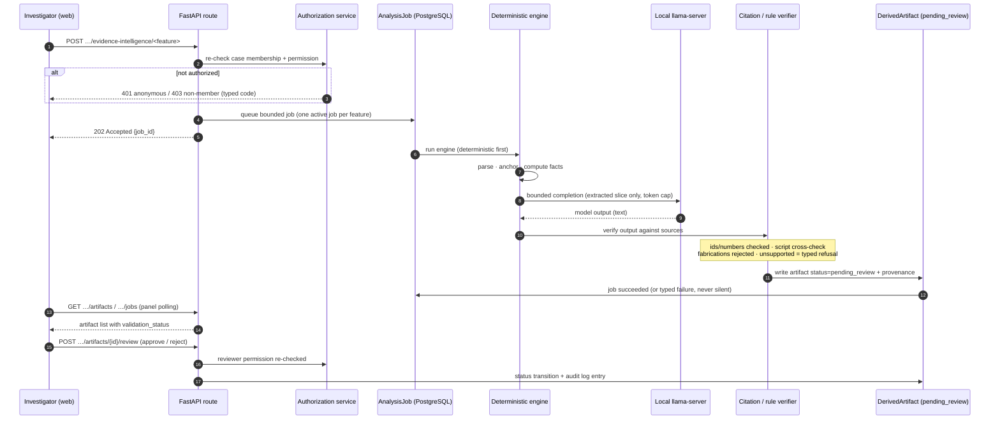

# AI request lifecycle

Every AI feature — the assistant, the nine analysis panels, the report
auditor — follows the same bounded pipeline. This is the single diagram to
understand "what happens when an investigator presses Run".

Invariants that hold for all ten capabilities:

1. **Deterministic engines compute; the model only explains.** Numbers,
   hashes, entity matches and flow facts come from Python services, never
   from the LLM.
2. **Nothing auto-applies.** Artifacts land as `pending_review`; approval or
   rejection is a human decision written to the audit log.
3. **Failures are typed.** Disabled feature, unavailable runtime, refusal,
   verification mismatch and timeout each have a distinct code — a failed
   run never renders as an empty success.
4. **Idempotent submission.** A second submit while a job is active returns
   409 `*_ACTIVE` instead of duplicating work; attempts are numbered so a
   retry after failure is safe.

Components: `app/ai/service.py` (bounded completions),
`app/services/analysis_jobs.py` (job rows), `app/services/artifacts.py`
(reviewable artifacts), `app/services/citations.py` (verification).

See also: [evidence ingestion & custody](evidence-ingestion-custody.md).
