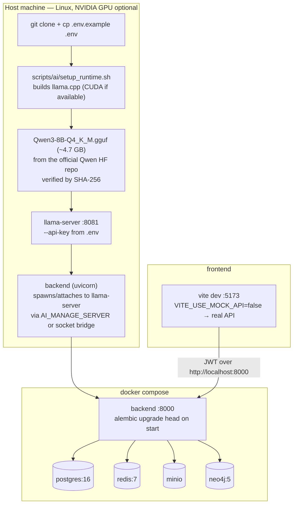

# Deployment & local model setup

Startup order and health checks:

| Step | Command | Health signal |
|------|---------|---------------|
| 1. Infrastructure | `docker compose up -d` | `docker compose ps` — all services healthy |
| 2. Backend | included above | `GET /api/v1/health` → 200, `GET /api/v1/ready` → 200 |
| 3. AI runtime | spawned by backend (or `scripts/ai/run_server.sh`) | `GET /api/v1/ai/status` → `ready: true`, `model_valid: true` |
| 4. Frontend | `cd frontend && npm run dev` | http://localhost:5173 serves the app |
| 5. First admin | `python -m scripts.create_admin` | idempotent — safe to re-run |
| 6. Demo data | `python -m scripts.seed_demo` / `seed_showcase_cases` | idempotent |

Facts worth knowing before you deploy:

- **The model is not in git.** `*.gguf` is gitignored; obtain the file from
  the official `Qwen/Qwen3-8B-GGUF` repository and verify its SHA-256 with
  `scripts/ai/verify_model.sh` before first run. See
  [local model setup](../ai/LOCAL_MODEL_SETUP.md).
- **GPU is optional but measured, not assumed.** The CUDA build of
  `llama-server` loads all layers by default (`AI_GPU_LAYERS=-1`); set it to
  `0` to force CPU-only. CPU throughput is usable for demos but is not a
  validated performance target.
- **Migrations are not silent.** The backend container runs
  `alembic upgrade head` on start; `alembic check` gates CI so an
  unapplied migration fails the build rather than the first request.
- **Secrets live in `.env`**, which is gitignored and never overwritten by
  any setup script; `.env.example` carries safe placeholders only.
- **Shutdown is clean:** `docker compose down` stops the stack; the
  backend's lifespan hook stops the llama-server it manages. Data volumes
  survive `down` and are only removed by an explicit `down -v`.

See also: [system architecture](system-architecture.md),
[troubleshooting](../ai/TROUBLESHOOTING.md).
