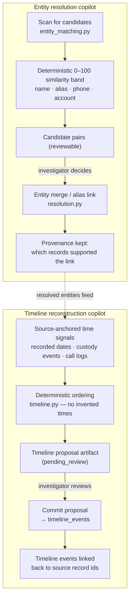

# Entity resolution & timeline reconstruction

Both features scan **already-ingested records only** — neither reads raw
files nor asks the model to invent entities or events.

Boundaries, stated exactly:

- **Resolution proposes; people decide.** The panel shows a similarity
  *band*, never a confident "these are the same person". Merging is an
  explicit investigator action with the supporting records attached.
- **Reconstruction orders what exists.** Every proposed event cites the
  source record that carries the timestamp; a record without one yields no
  event rather than an estimated one.
- **Commit is auditable.** Committing a proposal writes `timeline_events`
  rows that each retain their source-record id, so the graph view and the
  report can cite them.

Routes: `app/api/routes/case_intelligence.py`
(`…/entity-resolution`, `…/timeline-reconstruction`,
`…/timeline-proposals/{id}/commit`).
Services: `app/services/entity_matching.py`, `resolution.py`, `timeline.py`.

See also: [financial flow & cross-case](financial-flow-cross-case.md).
