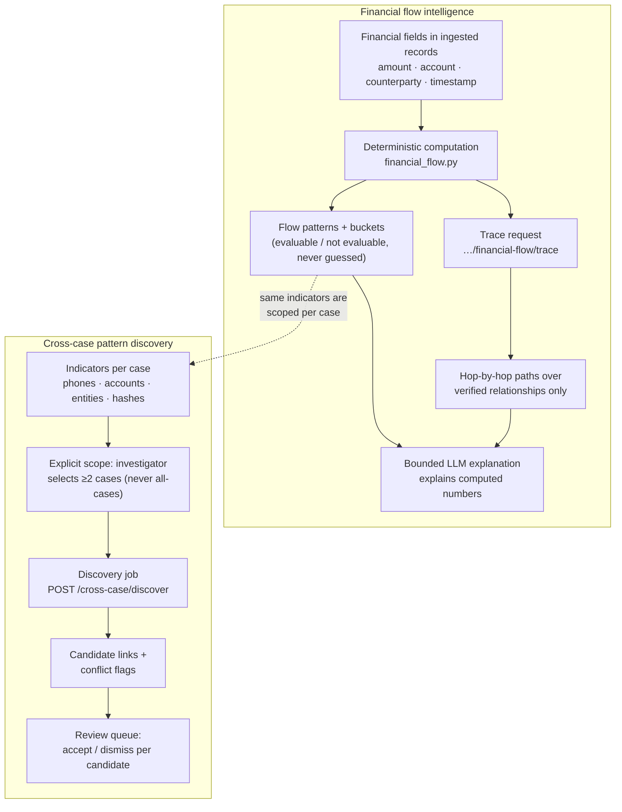

# Financial flow & cross-case linkage

Enforced boundaries:

- **No invented money.** Amounts and paths come from parsed records; a field
  that is missing or non-numeric makes a flow *not evaluable*, which the UI
  states plainly instead of showing a fabricated figure.
- **Trace walks verified edges only** — the same relationship rows the graph
  view renders, each hop citing its source record.
- **Cross-case discovery is always scoped.** The API requires an explicit
  list of ≥2 case ids that must include the requesting case; there is no
  "search every case" mode, so authorization stays per-case.
- **Conflicts surface, not suppressed.** Where indicators collide across
  cases (e.g. a shared device used by two suspects), the candidate carries a
  conflict flag the reviewer must read.

Routes: `app/api/routes/case_intelligence.py` (`…/financial-flow`,
`…/financial-flow/trace`), `app/api/routes/cross_case.py`.
Services: `app/services/financial_flow.py`, `cross_case.py`.

See also: [multilingual & forensics triage](multilingual-forensics.md).
