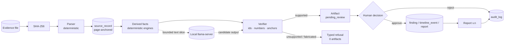

# End-to-End Investigation Workflow — Actual Implementation

**Status: implemented and verified.** Every endpoint, service and invariant named
here exists in the repository and is exercised by the test suite
(`backend/tests/e2e/test_investigator_workflow.py`, `backend/tests/api/*`) or by
`make demo-status` against the seeded showcase. Nothing here is aspirational.

Scope: how one complaint becomes one reviewed, versioned, audited report — and
where each of the ten AI capabilities sits inside that flow.

---

## 1. The workflow, step by step (mapped to real code)

| # | Stage | Route / entry point | Service | Persistence | Invariant |
|---|---|---|---|---|---|
| 1 | Authenticate | `POST /api/v1/auth/login` | `services/token.py` | sessions | JWT; role checks re-evaluated per request |
| 2 | Register/approve user (optional) | `POST /api/v1/auth/register` → admin approve | `services/users.py` | `user`, `user_role` | new users start `PENDING`; admin approval issues roles |
| 3 | Create case | `POST /api/v1/cases` | `services/authorization.py` | `case`, `case_member` | creator becomes member; every later call re-checks membership |
| 4 | Enter complaint / description | case description + complaint evidence text | — | `case`, `evidence_file` | complaints are evidence, never rewritten |
| 5 | Upload evidence | `POST /api/v1/cases/{case_id}/evidence` | `services/ingestion.py` | `evidence_file` | SHA-256 computed at intake; same bytes ⇒ same hash, no duplicates |
| 6 | Validate + hash | same call | `services/validation.py` | `evidence_file.sha256`, `source_record` | hash is computed server-side, never trusted from the client |
| 7 | Extract text/metadata | `POST /api/v1/cases/{case_id}/ingest` (async job) | `services/extraction.py`, `parsing.py` | `ingestion_job`, `source_record` | page-aware bounded extraction; unsupported formats typed refusals |
| 8 | Provenance + custody | automatic on ingest | `services/provenance.py`, `custody.py` | `evidence_custody_event` (CHECK-typed: collected/transferred/received/sealed/…) | custody rule set is deterministic — AI may explain, never create/dismiss |
| 9 | Entities + candidates | extraction → `services/entity_matching.py` | `entity`, `entity_alias`, `entity_candidate` | similarity **band + candidates only** — merge is a human action with provenance |
| 10 | Relationship candidates | `services/relationships.py` → `graph_sync.py` | `relationship`, `relationship_evidence` (Postgres) + Neo4j projection | every edge carries its evidence; graph is a projection, not a second truth |
| 11 | Timeline reconstruction | `POST /api/v1/cases/{case_id}/timeline-reconstruction` | `services/timeline_reconstruction.py` | `timeline_event` | source-anchored timestamps only; invented timestamps rejected by verifier; commit requires a human |
| 12 | Contradiction detection | `POST /api/v1/cases/{case_id}/contradiction-detection` | `services/contradiction_detection.py` | `finding` (type=contradiction) | anchored to source-record pairs; findings are **human-resolved only** |
| 13 | Financial flow | `POST /api/v1/cases/{case_id}/financial-flow` (+`/trace`) | `services/financial_flow.py` | derived artifacts | computes only from numeric fields present in records; absent stays absent |
| 14 | Cross-case discovery | `POST /api/v1/cross-case/discover` | `services/cross_case.py` | `entity_candidate`/candidates scoped ≥2 cases | read-only discovery over an **explicit scope** (never "all cases"); approval records a relationship, never merges cases |
| 15 | Multilingual analysis | `POST /api/v1/cases/{case_id}/evidence-intelligence/multilingual` | `services/multilingual.py` | translation artifacts | language label cross-checked against deterministic script profile; originals never rewritten; unsupported scripts → typed 422, 0 artifacts |
| 16 | Digital-forensics triage | `POST /api/v1/cases/{case_id}/evidence-intelligence/triage` | `services/forensic_triage.py` | triage artifact (observations) | structural observations only — no malware/phishing verdicts; **URLs never fetched** |
| 17 | Analytics run | `POST /api/v1/cases/{case_id}/analytics/run` | `analytics/*` (deterministic) | `analytics_run`, `finding` (status `NEW`) | findings start `NEW`; nothing auto-approves |
| 18 | Human review | `PATCH /api/v1/cases/{case_id}/findings/{id}/status` | `services/findings_service.py` | `finding.status` | reviewer → `REVIEWED`, then `CONFIRMED`/`DISMISSED`; every transition lands in the audit log |
| 19 | Report generation | `POST /api/v1/cases/{case_id}/reports` (+ AI draft `POST /api/v1/ai/report-draft`) | `services/reporting.py` | `report` (status `generating`→…, `minio_key`, `failure_reason`) | draft is grounded; report bytes live in MinIO, keyed in Postgres |
| 20 | AI report audit | `POST /api/v1/cases/{case_id}/report-audits` | `services/report_audit.py` | report audit (draft stored as **sha256 only**) | auditor never edits or files the report; artifacts are always `pending_review` + `flagged` |
| 21 | Human approve/reject | `PATCH` on the report audit | `services/report_audit.py` | audit record | approve/reject is a human decision recorded in the audit log |
| 22 | Preserve history | every mutating call | `services/audit.py` | `audit_log` (actor, action, resource, metadata) | append-only; the UI exposes it at `/app/audit` |

AI capabilities sit at stages **7, 11–16, 19–20** (capabilities 2–10) and as the
assistant/tool-loop at any stage (capability 1). Every AI stage follows the same
contract described in §3.

---

## 2. Diagrams

### 2.1 Investigation lifecycle

```mermaid
flowchart TB
    subgraph AuthN/AuthZ
        A[Login] --> B{Member of case?}
        B -- no --> X[403 / No access]
        B -- yes --> C
    end

    subgraph Intake["Intake — deterministic"]
        C[Create case] --> D[Upload evidence]
        D --> E[SHA-256 + validation]
        E --> F[Ingestion job<br/>text/metadata extraction]
        F --> G[Provenance + custody events]
    end

    subgraph Enrich["Enrichment — hybrid"]
        G --> H[Entity candidates + aliases]
        H --> I[Relationship candidates → graph projection]
        I --> J[Timeline reconstruction<br/>source-anchored, human commit]
        J --> K[Contradiction detection]
        K --> L[Financial flow analysis]
        L --> M[Cross-case discovery<br/>explicit ≥2-case scope]
        M --> N[Multilingual analysis]
        N --> O[Forensics triage]
    end

    subgraph Review["Review — human only"]
        O --> P[Analytics run → findings NEW]
        P --> Q[Investigator REVIEWED → CONFIRMED / DISMISSED]
    end

    subgraph Report["Report — versioned, audited"]
        Q --> R[Generate report]
        R --> S[AI report audit<br/>draft held as sha256]
        S --> T{Human approve / reject}
        T --> U[Report + audit history preserved]
    end

    style X fill:#3a1d22,stroke:#ff8b83
    style Q fill:#12301f,stroke:#5fc995
    style T fill:#12301f,stroke:#5fc995
```

### 2.2 Evidence-to-report pipeline (what is computed vs. what the model may say)

Five invariants hold on this pipeline (see `README.md` § "How every AI feature
is bounded"): deterministic engines own computation; the model only ever sees a
bounded slice and returns a candidate; a verifier checks every id/number against
the database; unsupported output becomes a typed refusal, not an answer; and no
artifact becomes trusted without a human.

---

## 3. Async jobs: retry, idempotency, partial completion

Facts from `services/analysis_jobs.py` and `services/ingestion.py`:

- **States:** `pending → running → succeeded | failed | partial | canceled`.
  `partial` exists so a partially-completed multi-step analysis stays visible
  instead of being relabelled as success.
- **Idempotent creation:** `create_job` is idempotent on
  `(case_id, idempotency_key)` — a retried request returns the existing job
  rather than creating a duplicate.
- **Restart recovery:** jobs run in-process; a job orphaned by a restart is
  detected and terminal-ized by the stale-job sweep (`_clear_stale_case_job`),
  so a restart never leaves a permanently `running` job blocking the case.
- **No invented progress:** jobs report state, not percentages.
- **Failure isolation:** an optional AI step failing returns a typed error for
  that step only; ingestion, hashes, custody, deterministic analytics and the
  case data remain intact (the AI gateway maps all model/runtime failures to
  `503 AI_UNAVAILABLE`, never to data corruption or a 500 leak).
- **Visibility:** every job is listable per case
  (`GET /api/v1/cases/{case_id}/ingest-jobs`, `…/evidence-intelligence/jobs`,
  `…/analytics/runs`) so partial completion is observable and re-runnable.

## 4. Security invariants maintained at every boundary

- **Authorization re-checked per request** — case membership and role are read
  from the database on each call (`services/authorization.py`), not from a
  stale token claim; `test_case_access_is_rechecked_after_permission_change`.
- **Case/tenant isolation** — every case-scoped query filters by the resolved
  case; cross-case discovery requires an explicit list of ≥2 case ids the caller
  may read; foreign conversations/resources return 404, not 403 leaks.
- **Evidence integrity** — hashes computed server-side; custody events append-only
  with a CHECK-constrained `event_type`; source references are checked by the
  eval harness's groundedness gate (every cited id must exist and belong to the
  case).
- **AI is bounded** — the model has 7 read-only tools, cannot write/delete, and
  prompt-injection tests prove case data stays fenced and user input cannot
  bypass case authz.
- **Audit trail** — every mutation writes `audit_log`; the frontend audit page
  paginates it with actor resolution.

## 5. Verification

| Evidence | What it proves |
|---|---|
| `backend/tests/e2e/test_investigator_workflow.py` | register → approve → case → evidence → ingest → analytics → NEW findings → review → confirm → audit history → RBAC denial |
| `make demo-seed` + `make demo-status` | the SIH showcase runs this pipeline via the real API and reports expected per-capability numbers |
| `scripts/ai/eval_model.sh` (41 golden entries) | AI answers at stages 19–20 cite only real, case-owned sources; refusals are 100% |
| `backend/tests/api/*` (423 tests) | each route's authz, validation and isolation rules |
