# Local AI Training Architecture — Fine-tuning, Evaluation & Rollback

**Scope:** how CyberSaarthi goes from the shipped quantized model to a
fine-tuned candidate and back — entirely on local hardware, with the baseline
never at risk. Every tool, path and gate named here exists in the repository.
Measured results of the actual run live in
[`docs/ai/FINE_TUNING_REPORT.md`](../ai/FINE_TUNING_REPORT.md); this document
describes the *architecture* those results were produced under.

Companion docs: [TRAINING_PIPELINE.md](../ai/TRAINING_PIPELINE.md) (verified
compatibility findings), [EVALUATION.md](../ai/EVALUATION.md) (baseline
metrics), [investigation-workflow.md](investigation-workflow.md) (where AI
capabilities sit in the product).

---

## 1. Components

| Component | Location | Role |
|---|---|---|
| Base checkpoint | `Qwen/Qwen3-8B` (HF safetensors, Apache-2.0) | The LoRA/QLoRA source — **never** the GGUF |
| Shipped baseline | `Qwen3-8B-Q4_K_M.gguf` (git-ignored) | Known-good runtime model; never overwritten |
| Training stack | `ai_runtime/soup/.venv` (Python 3.12.14, `soup-cli[train]`) | Isolated env — host Python 3.14 is unsupported by Soup |
| Trainer | Soup CLI (`soup train`, `soup merge`, `soup export`) | QLoRA recipe `qwen3-8b-sft` |
| Dataset builder | `scripts/ai/validate_dataset.py` | ChatML schema, provenance categories, dedup, leakage-safe split |
| Eval harness | `scripts/ai/eval_model.sh` → `backend/scripts/eval_model.py` | 41-entry golden set, hard gates, JSON report |
| Golden set | `backend/tests/fixtures/ai_golden.jsonl` | Frozen expected facts, citations, abstentions |
| Runtime switch | `AI_MODEL_PATH` in `.env` | One-line deploy **and** one-line rollback |
| Orchestration | `Makefile` (`train-check`, `train-pilot`, `eval`, `model-compare`, `model-rollback`) | One-command entry points |

### Isolation rules

- Training deps never touch `backend/.venv` or the container image — Soup lives
  in its own venv under `ai_runtime/` (git-ignored, like all artifacts).
- No cloud endpoints anywhere in the loop: download (HF), train (local GPU),
  evaluate (local llama-server over the Unix-socket bridge), deploy (file
  path swap).
- The GGUF is quantized inference format, **not** a valid training source —
  documented and enforced by using the HF safetensors as `base:` only.

## 2. Pipeline diagram

```mermaid
flowchart TB
    subgraph Prep["Preparation — deterministic"]
        FIX[(Synthetic fixtures<br/>+ eval golden set)] --> BUILDER[scripts/ai/validate_dataset.py<br/>ChatML schema · provenance categories<br/>dedup · no-real-data scan]
        BUILDER --> SPLIT["Stratified split<br/>train / val / test<br/>disjointness asserted"]
        SPLIT --> DS[(dataset.jsonl<br/>validated)]
    end

    subgraph Train["Training — local GPU"]
        BASE["Qwen/Qwen3-8B<br/>HF safetensors (Apache-2.0)"] --> QLORA["soup train --config<br/>QLoRA 4-bit · recipe qwen3-8b-sft"]
        DS --> QLORA
        QLORA --> ADAPTER[(adapter/ LoRA weights)]
        QLORA --> STATS["run stats:<br/>duration · peak VRAM · loss"]
    end

    subgraph Eval["Evaluation — same harness both sides"]
        ADAPTER --> MERGE["soup merge → candidate GGUF<br/>(separate file, never the baseline)"]
        MERGE --> CAND["candidate model<br/>non-default port smoke test"]
        BASE_Q4["Qwen3-8B-Q4_K_M.gguf<br/>(shipped baseline)"] --> HARNESS
        CAND --> HARNESS["scripts/ai/eval_model.sh<br/>41 golden entries<br/>groundedness 100% · abstention 100%<br/>fact recall · latency"]
        HARNESS --> CMP["model-compare<br/>baseline vs tuned, same golden set"]
    end

    subgraph Deploy["Decision — measured, not assumed"]
        CMP --> DECIDE{"candidate wins on<br/>gates + fact recall<br/>without gate regressions?"}
        DECIDE -- yes --> ADOPT["AI_MODEL_PATH → candidate<br/>(adopt)"]
        DECIDE -- no --> KEEP["keep baseline Q4_K_M<br/>(reject, documented)"]
        ADOPT --> ROLLBACK["model-rollback:<br/>AI_MODEL_PATH → baseline<br/>one command, no re-download"]
        KEEP --> ROLLBACK
    end

    style DECIDE fill:#12301f,stroke:#5fc995
    style BASE_Q4 fill:#12301f,stroke:#5fc995
```

## 3. Dataset contract

Every training row passes `scripts/ai/validate_dataset.py` before a run starts:

- **Schema** — ChatML `messages` (`system|user|assistant|tool`, non-empty
  content), optional `tools` (JSON-schema, `type: object`) and `tool_calls`
  (arguments parse as JSON and reference a declared tool).
- **Provenance** — each row carries one of ten categories (`case_qa`,
  `citation`, `ranking_tool`, `analytics_request`, `tool_args`, `abstention`,
  `conflict`, `report_draft`, `injection`, `isolation`) so the mix is auditable.
- **No real data** — live-looking case numbers, UUIDs, e-mails and credentials
  are rejected by scan; the set is synthetic/sanitized only.
- **Dedup** — exact + normalized conversation fingerprints; duplicates rejected.
- **Leakage guard** — deterministic stratified train/val/test split with a
  hard pairwise-disjointness assertion.

`--self-test` exercises all ten categories and cross-validates through Soup's
own `soup data validate --format chatml` when the venv is present.

## 4. Training configuration

QLoRA (4-bit base + LoRA adapters) is the only sane mode on a single 12 GB
RTX 3080 for an 8B model; Soup's memory table puts QLoRA-8B at ~5–6 GB VRAM.
Exact hyperparameters, quantization, LoRA rank/alpha, epoch/step counts and the
measured duration/peak-VRAM of the executed run are recorded in
[`docs/ai/FINE_TUNING_REPORT.md`](../ai/FINE_TUNING_REPORT.md) — this doc does
not restate numbers it did not measure.

Hard rules enforced by the workflow:

1. **No training run without a validated dataset** (`train-check` gate).
2. **Adapter is a separate artifact** — merge/export produces a new file; the
   baseline GGUF is never written to.
3. **Adopt only on measured improvement** — if the candidate does not beat the
   baseline on the same golden set without regressing the hard gates, the
   adapter is rejected and the report says so.

## 5. Evaluation & comparison

Both models run through the *identical* harness so the comparison is fair:

| Property | Baseline | Candidate |
|---|---|---|
| Model file | `Qwen3-8B-Q4_K_M.gguf` | merged candidate GGUF |
| Server | llama-server, default port/socket | llama-server, **non-default port** (smoke test first) |
| Harness | `eval_model.sh` → `eval_model.py` | same script, same golden set |
| Gates | groundedness 100%, abstention 100% | must also pass — no gate regressions |
| Reported | fact recall, latency, per-category counts | same metrics + sample counts |

`model-compare` writes both JSON reports side by side; the adopt/reject decision
is read from that comparison, never from vibes. Report fields include exact
sample counts (golden entries evaluated per category) so the numbers are
interpretable.

## 6. Deploy & rollback

```mermaid
flowchart LR
    A[.env] --> B{AI_MODEL_PATH}
    B -- "Qwen3-8B-Q4_K_M.gguf" --> C[(baseline<br/>known-good)]
    B -- "candidate.gguf" --> D[(fine-tuned<br/>adopted)]
    C --> E[llama-server<br/>run_server.sh]
    D --> E
    E --> F[socket_bridge → backend]
    G["model-rollback"] -. one command .-> B

    style C fill:#12301f,stroke:#5fc995
    style G fill:#12301f,stroke:#5fc995
```

- **Adopt:** set `AI_MODEL_PATH` to the candidate, restart the server, re-run
  `eval_model.sh` in the deployed configuration as a sanity check.
- **Rollback:** set `AI_MODEL_PATH` back to the baseline file, restart — the
  baseline file has been on disk the whole time; nothing needs re-downloading.
- **Config centralization:** model path, server binary, ports, context length
  and training artifact locations are read from `.env`/config in one place —
  no code edits to switch models (see Phase 5 config work).

## 7. Verification table

| Claim | Evidence |
|---|---|
| Dataset validator enforces schema/splits/no-real-data | `scripts/ai/validate_dataset.py --self-test` (green) |
| Static showcase fixture dataset is consistent | `make demo-validate` → 108 checks pass |
| Baseline metrics measured, not asserted | `ai_runtime/eval_report.json` + `docs/ai/EVALUATION.md` |
| Comparison is apples-to-apples | same harness, same `ai_golden.jsonl`, hard gates both sides |
| Rollback exists and is one command | `AI_MODEL_PATH` swap + `model-rollback` target |
| Training executed (or not) | [`FINE_TUNING_REPORT.md`](../ai/FINE_TUNING_REPORT.md) — duration, peak VRAM, loss, decision |

## 8. Documentation index

- [All architecture diagrams](README.md)
- [Investigation workflow](investigation-workflow.md)
- [AI feature status matrix](../ai/FEATURE_STATUS.md)
- [Training pipeline (verified findings)](../ai/TRAINING_PIPELINE.md)
- [Fine-tuning report (measured results)](../ai/FINE_TUNING_REPORT.md)
