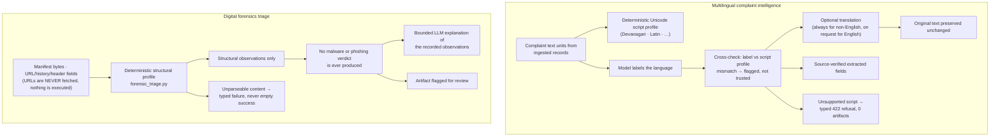

# Multilingual complaint intelligence & digital forensics triage

Boundaries, verbatim from the implementation:

- **The language label is not trusted on its own.** It is cross-checked
  against the deterministic script profile; a disagreement is surfaced as a
  finding rather than silently corrected.
- **Originals are immutable.** Translation creates a derived artifact; the
  source text and its hash are never rewritten.
- **Triage is structural, not judgemental.** It reports what the bytes and
  headers structurally contain. "This is malware" / "this is a phishing
  site" are outputs the system deliberately cannot produce.
- **No network fetches during triage.** URLs found in evidence are recorded
  and profiled as strings; the service does not resolve or download them.

Routes: `app/api/routes/evidence_intelligence.py`
(`…/multilingual`, `…/triage`).
Services: `app/services/multilingual.py`, `forensic_triage.py`.

See also: [report audit workflow](report-audit.md).
