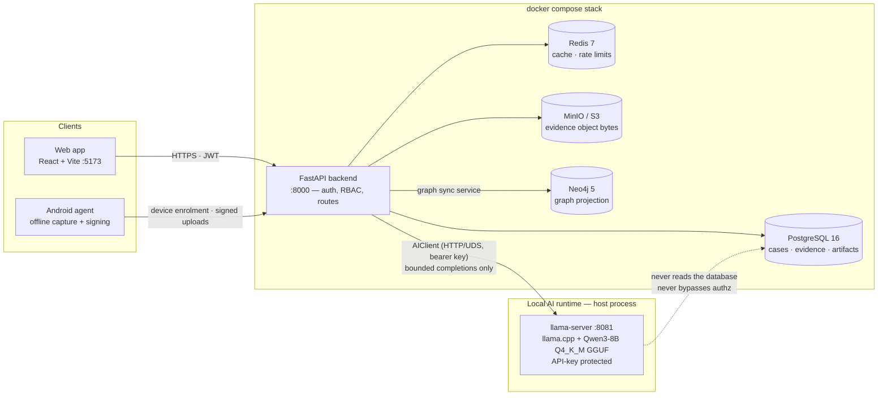

# System architecture

The whole platform runs from one `docker compose` stack plus a local AI
runtime. Every arrow below is a real, currently-implemented dependency —
there is no cloud LLM call anywhere in the request path: the backend talks
only to a local `llama-server` process (see [local model setup](deployment-setup.md)).

Key properties the diagram encodes:

- **The LLM is not a data source.** `AIClient` sends bounded prompts and
  receives text; every number and id in an answer is verified afterwards by
  the deterministic citation checker (`app/services/citations.py`). The model
  has no database credentials and no route access.
- **Authz is enforced per request.** Every case/evidence route resolves
  membership through `app/services/authorization.py` before any work runs;
  background jobs re-check authorization when they execute, not only at
  submit time.
- **Evidence bytes live in MinIO**, hashes in PostgreSQL; the AI runtime sees
  only extracted text slices that a job explicitly passes to it.

See also: [AI request lifecycle](ai-request-lifecycle.md) and
[deployment and setup](deployment-setup.md).
